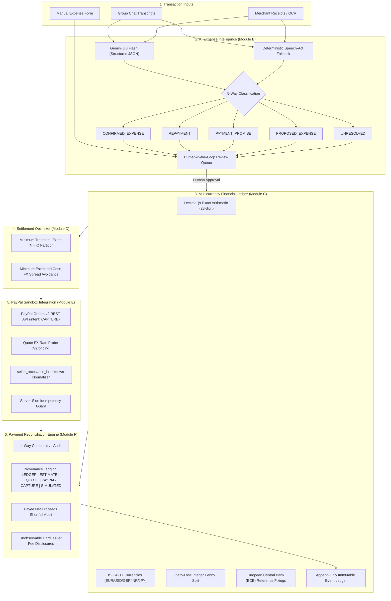

# ClearSettle — AI-Assisted Group Expense Reconciliation Platform

> **"Know what your group owes. See what payments actually cost."**

[](LICENSE)
[](https://www.typescriptlang.org/)
[](tests/)
[](https://developer.paypal.com/)
[](https://ai.google.dev/)

ClearSettle is a full-stack, fintech-grade group expense reconciliation platform built for the PayPal Hackathon. 

When international travel groups share expenses across currencies, their internal group accounting and real-world payment outcomes diverge: friends may calculate that someone owes €100, but they rarely know what exchange rate was applied, what processor fees were deducted, what amount the recipient actually received, or what card issuer fees were levied.

ClearSettle bridges this gap: **every financial obligation is traceable to its original evidence, every currency conversion has a recorded central bank source, every calculation uses exact decimal arithmetic, and every completed payment transaction has a verifiable outcome.**

---

## 1. Five-Command Quickstart

Get ClearSettle running locally in under two minutes:

```bash
# 1. Install dependencies
npm install && npm run build --prefix client

# 2. Reset and seed demonstration database
npm run seed

# 3. Run automated verification test suite
npm test

# 4. Compile client assets and server bundle
npm run build

# 5. Start unified full-stack application (server + client on port 5000)
npm run server
```

The application is now live at **`http://localhost:5000`**.

---

## 2. System Architecture



---

## 3. Core Modules & Fintech Disciplines

### Module A — Group Management
- **International Travel Groups**: Supports multi-currency group management with member-specific home countries and preferred currencies.
- **Pre-Seeded Hackathon Trip**: Seeded with **Alex (Germany — EUR)**, **Sam (United States — USD)**, and **John (Japan — JPY)**.
- **Dynamic Multicurrency Balances**: Displays net group exposure in the group's accounting base currency and converted to each participant's preferred currency.

### Module B — AI Expense Intelligence & Speech-Act Classifier
- **Strict 5-Way Classification**:
  1. `CONFIRMED_EXPENSE`: Completed group purchases with known payers and amounts.
  2. `REPAYMENT`: Executed debt reimbursements between members.
  3. `PAYMENT_PROMISE`: Statements of intent (*"I'll send you €150"*) — strictly isolated from settled cash.
  4. `PROPOSED_EXPENSE`: Contemplated future group purchases.
  5. `UNRESOLVED`: Disputed statements (*"Wait, John was supposed to cover dinner"*) or missing critical terms.
- **Human-in-the-Loop Gate**: Extracted transactions **never enter the ledger automatically**. Every item requires human review, parameter adjustments, and explicit sign-off.
- **Dual Engine**: Uses **Google Gemini 3.8 Flash** via strict JSON schema mode, backed by a linguistic speech-act regex parser when offline or without an API key.
- **Empirical AI Benchmark**: Labeled benchmark of 32 test cases evaluated in [`evidence/ai_eval.md`](evidence/ai_eval.md) (100% held-out test accuracy).

### Module C — Deterministic Financial Engine
- **Exact Decimal Arithmetic**: Uses `Decimal.js` (28-digit precision). Floating-point arithmetic (`0.1 + 0.2 = 0.30000000000000004`) is strictly forbidden.
- **ISO 4217 Compliance**: Full support for varying currency minor units (EUR, USD, GBP, INR with 2 decimals; JPY with 0 decimals).
- **Zero-Loss Penny Allocation**: Splits shares using integer minor-unit division with remainder penny distribution, guaranteeing $\sum \text{shares} = \text{total}$ to the last cent.
- **Central Bank Reference Provenance**: Every currency conversion records the reference exchange rate, timestamp, rate direction, and official source (European Central Bank reference fixings).

### Module D — Settlement Optimizer
Presents two distinct, transparent optimization strategies:
1. **Minimum Transfers (Zero-Sum Partition Theorem)**:
   - For groups up to $N \le 12$, computes the exact minimum number of transfers using subset-sum zero-sum partitioning:
     $$\text{Transfers} = N - K$$
     where $K$ is the maximum number of disjoint subsets that each sum to zero.
   - Property-tested against exhaustive recursive partition algorithms for $N \le 8$.
2. **Minimum Estimated Settlement Cost**:
   - Prioritizes pairing participants with identical currencies first to eliminate 2.5% retail FX spreads before routing cross-currency balances.
   - Models fixed processor capture fees ($0.49/€0.39/£0.39/¥40), cross-border surcharges (1.50%), and retail exchange spreads from centralized configuration ([`server/config/fees.ts`](server/config/fees.ts)).

### Module E — PayPal Sandbox Integration
- **Official Orders v2 REST API**: Server-side order creation (`intent: CAPTURE`) and server-side capture verification.
- **Provider Abstraction**: Extensible `PaymentProvider` interface supporting `PayPalCheckoutSandboxAdapter`, `DemoProviderAdapter`, and `ManualPaymentAdapter`.
- **Capture Verification & Normalization**: Extracts `seller_receivable_breakdown` (gross amount, PayPal processing fee, net amount, exchange rate, receivable amount).
- **Idempotency Protection**: Enforces server-side idempotency using unique request headers to prevent duplicate captures.

### Module F — Payment Reconciliation Engine (The Showcase Centerpiece)
Performs a 4-way comparative audit across distinct financial realities:
1. **Ledger Value**: Original debt amount, reference exchange rate, rate source (ECB), and base conversion.
2. **Provider Quotation**: Quoted amount and currency, with transparent disclosure when pre-capture quotes are unavailable.
3. **Actual Provider Result**: Verified capture ID, gross captured, PayPal processing fee deducted, net proceeds credited to payee, and effective rate.
4. **Reconciliation Analysis**: Variance between expected gross and captured gross, fee friction cost, payee proceeds shortfall, and notice of unobservable card issuer fees.

---

## 4. How Judges Test ClearSettle

ClearSettle supports two distinct evaluation modes:

### Mode 1: Zero-Config Demo Mode (Zero Credentials Required)
ClearSettle includes an interactive demo mode where judges can test the full workflow without setting up PayPal developer accounts or API keys:

1. In `.env`, set:
   ```env
   ENABLE_DEMO_PROVIDER=true
   ```
2. Run the application:
   ```bash
   npm run build && npm run server
   ```
3. Open `http://localhost:5000`:
   - Follow the step-by-step walkthrough in [`docs/demo.md`](docs/demo.md).
   - Test AI transcript parsing on the AI Expense page.
   - Review pending transactions in the Review Queue.
   - Compare settlement strategies (Min Transfers vs. Min Cost).
   - Simulate a PayPal capture in the Settlement modal.
   - Inspect the Reconciliation dashboard: notice the prominent **SIMULATED** warning banners and provenance badges on every simulated number.

### Mode 2: Live PayPal Sandbox Mode (Real Captures & Harness)
To run live sandbox captures against PayPal's Orders v2 REST API:

1. In `.env`, provide your PayPal sandbox credentials:
   ```env
   ENABLE_DEMO_PROVIDER=false
   PAYPAL_CLIENT_ID=your_sandbox_client_id
   PAYPAL_CLIENT_SECRET=your_sandbox_client_secret
   PAYPAL_ENVIRONMENT=sandbox
   GEMINI_API_KEY=your_gemini_api_key
   ```

2. **Probe PayPal's Pre-Capture Quote API**:
   ```bash
   npm run probe:quote
   ```
   *Probes `POST /v2/pricing/quote-exchange-rates` across currency pairs (USD/EUR, EUR/USD, JPY/EUR) and records the real HTTP response and status in [`evidence/quote_probe.json`](evidence/quote_probe.json).*

3. **Run the 6-Pair Empirical Evidence Capture Harness**:
   ```bash
   npm run evidence
   ```
   *Creates orders across 6 currency corridors (USD $\rightarrow$ EUR, JPY $\rightarrow$ EUR, EUR $\rightarrow$ USD, GBP $\rightarrow$ EUR, EUR $\rightarrow$ JPY, USD $\rightarrow$ GBP), prints the buyer authorization URL, polls for approval, captures via Orders v2 API, normalizes `seller_receivable_breakdown`, computes ECB reference spread, and writes [`evidence/summary.csv`](evidence/summary.csv).*

4. **View Real Captured Evidence in the UI**:
   - Start the server (`npm run server`) and navigate to `http://localhost:5000/reconciliation`.
   - The UI automatically loads and renders the empirical measured audit table from `evidence/summary.csv` with `[PAYPAL-CAPTURE]` provenance badges!

---

## 5. Automated Verification & Test Suite

ClearSettle features 20 automated tests spanning ledger math, property-based partition solvers, fee models, AI classification, and error resilience:

```bash
npm test
```

### Verified Test Suites:
1. **`tests/financial.test.ts` (6 tests)**:
   - ISO 4217 minor unit formatting and precision (EUR, USD, GBP, INR 2 decimals; JPY 0 decimals).
   - Zero-cent split remainder distribution: ensures penny conservation across unequal shares.
   - ECB reference rate conversion direction and audit metadata.
2. **`tests/optimizer.test.ts` (3 tests)**:
   - Zero-sum group balance invariant conservation ($\sum \text{balances} = 0$).
   - Exact subset-sum partitioning ($N - K$ transfers) for $N \le 12$.
   - Cost-aware settlement routing: verifies avoidance of retail FX spreads.
3. **`tests/optimizer-property.test.ts` (3 tests)**:
   - Randomized property-based validation of $N - K$ solver against recursive brute-force for $N \le 8$.
   - Conservation of money across all generated settlement transfers.
   - Integer minor unit preservation (including 0-decimal JPY).
4. **`tests/ai.test.ts` (2 tests)**:
   - Speech-act classification across all 5 classes (`CONFIRMED_EXPENSE`, `REPAYMENT`, `PAYMENT_PROMISE`, `PROPOSED_EXPENSE`, `UNRESOLVED`).
   - Adversarial text handling (distinguishing promises from executed payments).
5. **`tests/reconciliation.test.ts` (4 tests)**:
   - PayPal capture normalization of `seller_receivable_breakdown`.
   - 4-way reconciliation variance math (gross variance, fee friction, net shortfall).
   - Honest quote unavailability reporting.
6. **`tests/demo-hardening.test.ts` (2 tests)**:
   - Server capture error handling: returns `CAPTURE_FAILED` with upstream error message without crashing.
   - Idempotency guard: duplicate capture calls with identical order IDs are safely rejected.

---

## 6. Responsible Fintech Disclosures & Limitations

ClearSettle adheres to transparent fintech engineering standards:

1. **Merchant Checkout vs. P2P Settlement**:
   PayPal's Orders v2 REST API is a **commercial Checkout model**, not a universal peer-to-peer (P2P) debt settlement network. Transactions are captured under merchant processing fee rules (e.g. 3.49% + $0.49). ClearSettle explicitly distinguishes merchant Checkout captures from internal ledger obligations and never represents a merchant payment as a P2P transfer.
2. **Pre-Capture FX Rate Quotations**:
   Standard PayPal developer sandbox accounts do not provide pre-authorization exchange rate quotes via `/v2/pricing/quote-exchange-rates` (returns HTTP 403/404). Real-time conversion options are selected dynamically by buyers at PayPal login. ClearSettle displays the exact HTTP status returned and labels quotes as unavailable.
3. **Payee Multi-Currency Account Balances**:
   When capturing cross-border transactions in sandbox, if the receiving merchant account holds a balance in the transaction currency, PayPal credits that currency balance directly without an immediate conversion (omitting `seller_receivable_breakdown.exchange_rate`). ClearSettle documents this behavior in [`evidence/summary.md`](evidence/summary.md).
4. **Unobservable External Charges**:
   Card issuer foreign transaction fees (typically 1–3% charged by credit card banks) occur outside the PayPal network and cannot be observed via PayPal APIs. ClearSettle explicitly labels these costs as unobservable.
5. **Centralized Transparent Fee Constants**:
   All fee percentages, fixed fees, and cross-border surcharges are defined in [`server/config/fees.ts`](server/config/fees.ts) with direct links to official PayPal documentation and retrieval dates.

---

## 7. Project Structure & Key Files

```
clearsettle/
├── client/                     # Vite + React + Tailwind frontend
│   └── src/
│       ├── pages/              # Dashboard, Ledger, AI Import, Review Queue, Settlement, Reconciliation
│       └── components/         # ProvenanceBadges, Disclaimers, Modals, Navbar
├── server/                     # Express + TypeScript backend
│   ├── ai/                     # Gemini 3.8 Flash service & Speech-Act Classifier
│   ├── config/fees.ts          # Centralized PayPal fee constants with documentation URLs
│   ├── ledger/                 # Decimal.js arithmetic, ISO 4217, ECB reference fixings
│   ├── optimizer/              # (N - K) Zero-Sum Subset Solver & Cost Model
│   ├── paypal/                 # Orders v2 REST Client & Adapters
│   ├── seed.ts                 # Realistic seeded 3-member trip dataset
│   └── index.ts                # REST API routes & database operations
├── evidence/                   # Empirical verification artifacts (NEVER FABRICATED)
│   ├── ai_eval.md              # 32-sample benchmark & 5x5 confusion matrix
│   ├── quote_probe.json        # Live /v2/pricing/quote-exchange-rates HTTP response
│   ├── summary.csv             # Empirical sandbox capture audit table
│   └── summary.md              # Empirical analysis report
├── docs/
│   └── demo.md                 # 3-Minute Golden Path judging script
├── tests/                      # Automated Vitest test suites
├── LICENSE                     # MIT License
└── package.json
```

---

## 8. License

This project is licensed under the [MIT License](LICENSE).
