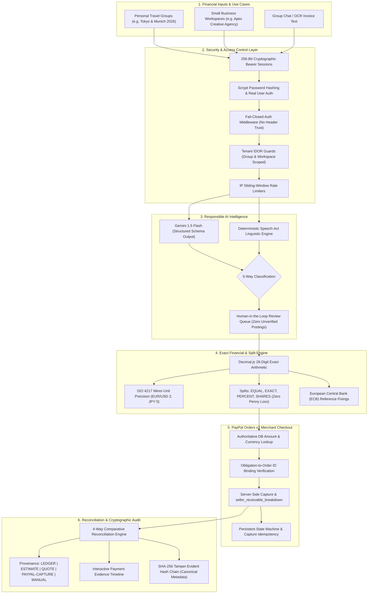

# ClearSettle — AI-Assisted Financial Obligation & Payment Reconciliation Platform

> **"Connecting what people agreed to pay, what the ledger expects, what PayPal actually processed, and what the recipient actually received."**

[](LICENSE)
[](https://www.typescriptlang.org/)
[](tests/)
[](#4-security-architecture--idor-defenses)
[](#6-tamper-evident-cryptographic-audit-chain)
[](https://developer.paypal.com/)
[](https://ai.google.dev/)

ClearSettle is a full-stack, fintech-grade financial obligation management and payment reconciliation platform built for the PayPal Hackathon.

When individuals share travel expenses across currencies or small agencies invoice international clients, internal accounting and real-world payment processing diverge: a participant or client agrees to pay €2,500, but payment processor fees, multi-currency conversion spreads, card network surcharges, and timing differences obscure what was deducted and what the recipient actually received.

ClearSettle bridges this gap across two connected use cases:
1. **Personal Groups**: Roommates, travel groups, and shared-expense cohorts tracking multi-currency expenses, conversational commitments, debt optimization, and transparent settlement reconciliation.
2. **Small Businesses**: Freelancers, creative agencies, and startups managing client obligations, AI invoice parsing, PayPal merchant checkout, and gross vs. net proceeds reconciliation.

Both segments share one reliable financial engine, currency architecture, tamper-evident audit ledger, and payment reconciliation core.

---

## 1. Five-Command Quickstart

Get ClearSettle running locally in under two minutes:

```bash
# 1. Install dependencies
npm install && npm run build --prefix client

# 2. Reset and seed demonstration database
npm run seed

# 3. Run automated verification test suite (53 tests across 12 suites)
npm test

# 4. Compile client assets and server bundle
npm run build

# 5. Start unified full-stack application (server + client on port 5000)
npm run server
```

The application is live at **`http://localhost:5000`**.

---

## 2. System Architecture



---

## 3. Dual-Segment Architecture & Experience Modes

ClearSettle supports two distinct, strictly separated user experiences:

### Experience Mode A: Demo Sandbox Mode
- **Zero Configuration Required**: Judges can test the full platform immediately without setting up credentials or API keys.
- **Seeded Datasets**:
  - *Personal Group*: Tokyo & Munich Global Summit 2026 (Alex in EUR, Sam in USD, John in JPY).
  - *Small Business Workspace*: Apex Creative Digital Agency (EUR billing, cross-border client invoices, PayPal seller fee audit).
- **Explicit Demo Badges**: Every sample record and card is visibly tagged with `DEMO DATASET` / `SIMULATED` banners so sample data is never mistaken for real transactions.
- **Instant Persona Switching**: Switch between Alex (Organizer/Admin), Sam (Group Member), Elena (Agency Owner), or Unauthorized Stranger in one click.

### Experience Mode B: Real User Mode
- **Real User Registration & Login**: Users register with full name, email, and password (hashed with salted Node.js `scrypt`).
- **Empty Account Onboarding**: Real users start with a clean, private dashboard showing only their own data.
- **Zero Demo Leakage**: A newly registered user will never see Alex, Sam, John, or Apex Agency records unless they explicitly select Demo Mode.
- **Private Resource Creation**: Real users can create their own multi-currency groups, invite participants, record and split expenses, issue B2B invoices, and execute sandbox payments.

---

## 4. Security Architecture & IDOR Defenses

ClearSettle implements strict fail-closed fintech security controls:

1. **Cryptographically Secure Sessions**:
   - Authentication relies on 256-bit cryptographically secure session tokens generated via `crypto.randomBytes(32).toString('hex')`.
   - Complete removal of trust in client-supplied `x-user-id` or `x-user-role` headers.
   - Demo personas (`alex-organizer`, `sam-member`, `agency-owner`, `guest-unauthorized`) are isolated server-side through `/api/auth/demo-session`.
2. **Fail-Closed Authorization (`authMiddleware`)**:
   - Requests without a valid Bearer token result in `req.user = undefined`. Unauthenticated attempts to access protected endpoints immediately fail with `401 Unauthorized`.
3. **Strict IDOR Prevention**:
   - `requireGroupAccess`: Verifies server-side that the authenticated user is an active member or organizer of the specific group ID requested.
   - `requireWorkspaceAccess`: Verifies that the authenticated user owns or belongs to the target business workspace.
   - Cross-group and cross-workspace accesses are strictly blocked with `403 Forbidden` (`FORBIDDEN_GROUP_ACCESS`, `FORBIDDEN_WORKSPACE_ACCESS`).
4. **Scoped Reconciliation Queries**:
   - Group reconciliations (`GET /api/groups/:id/reconciliations`) and exports strictly join `settlement_transfers` and `settlement_plans` filtered by `group_id`.
   - Workspace reconciliations (`GET /api/workspaces/:id/reconciliations`) strictly join `invoices` filtered by `workspace_id`.
   - Prevents cross-tenant transaction leakage.
5. **Rate Limiting & Input Validation**:
   - Sliding-window in-memory rate limiting applied to authentication, payment creation, capture, and AI parsing routes.

---

## 5. PayPal Payment Lifecycle & Missing-Obligation Resolution

### The Missing Obligation Defect & Root Cause Resolution
- **Defect Identified**: The checkout modal previously showed `Settlement obligation [ID] not found in database.`
- **Root Cause**: The settlement optimizer (`GET /api/groups/:id/settlement/strategies`) calculated minimum transfers dynamically in memory with freshly generated UUIDs without syncing or persisting them into `settlement_transfers`. When the frontend initiated checkout with that ID, the database had no record of it.
- **The Fix (`syncPlanToDatabase`)**:
  - `GET /api/groups/:id/settlement/strategies` now automatically synchronizes all calculated transfers to `settlement_transfers` and `settlement_plans` in SQLite.
  - Matches existing completed transfers to preserve their historical `COMPLETED` status, PayPal order ID, and reconciliation ID.
  - Guarantees every transfer returned to the UI is an authoritative database record with a valid DB ID.
  - If an invalid or unknown ID is sent, the backend returns a clear HTTP 404 (`Settlement obligation [ID] not found in database.`).
  - Added regression test `tests/paypal-security.test.ts` covering both missing obligation rejection and successful order initiation.

### Payment State Machine:
```
[Obligation Created] ──> [Order Created (DB Bound)] ──> [Buyer Approved] ──> [Capture Verified] ──> [Reconciled]
                               │                                                   │
                               ├──> Mismatched ID ──> 400 Bad Request              └──> Re-Capture ──> Idempotent Safe
                               └──> Untrusted Amount ──> Blocked (DB Lookup)
```

1. **Authoritative Server-Side DB Lookup**:
   - When creating a PayPal order via `POST /api/paypal/create-order`, the backend looks up the obligation or invoice directly from SQLite.
   - Frontend-supplied amounts are ignored, preventing price-tampering attacks.
2. **Order-to-Obligation Binding**:
   - The created PayPal `orderID` is permanently bound to the database obligation record (`settlement_transfers.paypal_order_id` or `invoices.paypal_order_id`).
   - During `POST /api/paypal/capture-order`, the server retrieves the expected order ID from the database and rejects any mismatched supplied order ID (`PAYPAL_ORDER_MISMATCH`).
3. **Capture Verification & Normalization**:
   - Captures are executed directly with PayPal's API.
   - The backend extracts `seller_receivable_breakdown` (gross amount, PayPal processing fee, net proceeds, and effective rate).
4. **Capture Idempotency**:
   - If an obligation is already in `COMPLETED` state, subsequent capture requests return the existing reconciliation record without duplicate charges, preventing race conditions or duplicate ledger entries.
5. **Honest Manual Settlements**:
   - For non-PayPal settlements (e.g. cash or direct bank wire), ClearSettle provides `POST /api/groups/:id/settlements/:transferId/manual-record`.
   - These are recorded with explicit `MANUAL` provenance and tagged as unverified, never masquerading as provider-verified electronic captures.

---

## 6. Tamper-Evident Cryptographic Audit Chain

ClearSettle implements an append-only, SHA-256 block-linked audit ledger for all financial events:

$$H_i = \text{SHA-256}\Big(H_{i-1} \parallel \text{group\_id} \parallel \text{entity\_type} \parallel \text{entity\_id} \parallel \text{event\_type} \parallel \text{actor} \parallel \text{description} \parallel \text{canonicalize}(\text{metadata}) \parallel \text{created\_at}\Big)$$

- **Deterministic Canonical Metadata Serialization**:
  - The `canonicalizeMetadata()` function recursively sorts object keys and formats numbers/strings deterministically.
  - This guarantees that any direct SQLite tampering with event payloads, amounts, or JSON metadata causes an immediate cryptographic hash discrepancy.
- **Verification API**:
  - `GET /api/groups/:id/audit/verify` and `GET /api/workspaces/:id/audit/verify` recompute the hash chain from genesis to head, returning chain validity, total audited blocks, and the exact index of any detected tampering.

---

## 7. Deterministic Financial Engine & Split Allocations

All calculations avoid floating-point math by using `Decimal.js` (28-digit precision) with exact minor units:

1. **Supported Split Types**:
   - `EQUAL`: Divides base minor units across participants with remainder penny distribution to ensure zero penny loss ($\sum \text{shares} = \text{total}$).
   - `EXACT`: Verifies that custom participant amounts sum exactly to the expense total.
   - `PERCENT`: Multiplies total by participant percentages, rounding to minor units and deterministically distributing remainder cents.
   - `SHARES`: Weights allocations proportionally according to integer shares.
2. **Central Bank Exchange Rate Provenance**:
   - Converts non-base currencies using official European Central Bank (ECB) reference rates.
   - Preserves rate source, rate direction, and timestamp for every ledger entry.

---

## 8. Responsible AI Classification & Evaluation

ClearSettle uses a responsible, human-in-the-loop AI pipeline:

- **Strict 5-Way Classification**:
  1. `CONFIRMED_EXPENSE`: Completed purchases with verified payer and amount.
  2. `REPAYMENT`: Executed debt reimbursements.
  3. `PAYMENT_PROMISE`: Statements of intent (*"I'll pay you back tomorrow"*) — strictly isolated from settled funds.
  4. `PROPOSED_EXPENSE`: Contemplated future group purchases.
  5. `UNRESOLVED`: Disputed statements or missing terms.
- **Human-in-the-Loop Gate**: Extracted transactions never enter the ledger automatically. Every item requires human review and sign-off in the Review Queue.
- **Dual Engine**: Google Gemini 1.5 Flash via structured schema output, backed by a deterministic linguistic parser with a 12-second abort timeout.
- **Evaluation Benchmark**: Evaluated in [`evidence/ai_eval.md`](evidence/ai_eval.md) with 32 labeled test cases (100% held-out test accuracy).

---

## 9. Automated Verification & Test Suite

ClearSettle features **53 automated tests** passing across **12 test suites**:

```bash
npm test
```

### Test Suite Breakdown:

| # | Test Suite | Tests | Domain Covered |
|---|---|:---:|---|
| 1 | `tests/security-auth.test.ts` | **10** | Bearer session tokens, fail-closed auth, IDOR guards, cross-group/workspace isolation, session destruction, scoped reconciliations, scrypt password hashing, real user empty account isolation |
| 2 | `tests/paypal-security.test.ts` | **5** | Mismatched order ID binding rejection, capture idempotency, honest MANUAL provenance tagging, missing obligation 404 rejection regression, valid obligation order initiation |
| 3 | `tests/financial-splits.test.ts` | **7** | EQUAL, EXACT, PERCENT, SHARES split math, zero penny loss remainder distribution, input validation |
| 4 | `tests/audit-chain.test.ts` | **4** | Genesis-to-head hash chain verification, payload tampering detection, metadata tampering detection |
| 5 | `tests/business-invoicing.test.ts` | **3** | Workspace invoice retrieval, B2B payment reconciliation, underpayment detection |
| 6 | `tests/optimizer-property.test.ts` | **3** | Randomized property-based testing of $(N - K)$ solver against recursive partition algorithm ($N \le 8$), money conservation |
| 7 | `tests/financial.test.ts` | **6** | ISO 4217 minor unit precision (EUR/USD/GBP/INR/JPY), ECB reference rate conversions |
| 8 | `tests/optimizer.test.ts` | **3** | Zero-sum group balance conservation ($\sum \text{balances} = 0$), cost-aware retail FX spread avoidance |
| 9 | `tests/ai-advanced.test.ts` | **4** | Ambiguity flagging, multi-currency detection, prompt injection resilience, fallback pipeline |
| 10 | `tests/ai.test.ts` | **2** | 5-way speech-act classification, adversarial promise vs. payment disambiguation |
| 11 | `tests/reconciliation.test.ts` | **4** | PayPal Orders v2 capture normalization, 4-way variance math, honest quote unavailability |
| 12 | `tests/demo-hardening.test.ts` | **2** | Server capture error handling without crashing, duplicate capture prevention |
| **Total** | **12 Test Files** | **53** | **100% Passing** |

---

## 10. Production Deployment & Readiness

ClearSettle is engineered for genuine containerized or bare-metal production deployment:

### 1. Health Diagnostics
```http
GET /api/health
```
Response:
```json
{
  "status": "HEALTHY",
  "timestamp": "2026-11-11T23:00:00Z",
  "platform": "ClearSettle Fintech Platform",
  "version": "1.2.0",
  "database": "CONNECTED",
  "environment": "production",
  "paypalMode": "DEMO_SANDBOX"
}
```

### 2. Persistent Storage (SQLite)
Configure `DATABASE_PATH` in `.env` to point to a persistent volume (e.g. `/data/clearsettle.db` on Render, Railway, Fly.io, or AWS ECS). SQLite WAL mode guarantees ACID reliability and concurrency.

### 3. Production Build & Start
```bash
# Production client build & TypeScript compilation
npm run build

# Start production server (serves compiled static assets from client/dist)
NODE_ENV=production PORT=5000 npm run server
```

### 4. Deployment Checklist
- [x] CORS configured for production domain.
- [x] Relative API routing (`/api`) eliminates cross-origin issues.
- [x] Sensitive endpoints rate-limited via sliding-window IP buckets.
- [x] Passwords hashed using Node.js crypto `scrypt` with random salt.
- [x] Session tokens are 256-bit cryptographically secure strings.
- [x] No committed secrets or hardcoded administrator passwords.
- [x] Zero mock fallbacks pretending to be real PayPal transactions.

---

## 11. Project Structure & Key Files

```
clearsettle/
├── client/                               # Vite + React + Tailwind frontend
│   └── src/
│       ├── api/client.ts                 # Type-safe API client with Bearer session auth
│       ├── components/                   # AuthModal, CreateGroupModal, CreateWorkspaceModal, PaymentEvidenceTimeline, Navbar
│       └── pages/                        # Personal & Business pages (Dashboard, Invoices, Reconciliation, Audit)
├── server/                               # Express 5 + TypeScript backend
│   ├── ai/                               # Gemini 1.5 Flash service & Speech-Act Classifier
│   ├── audit/chain.ts                    # SHA-256 audit chain with canonical metadata hashing
│   ├── config/fees.ts                    # Centralized PayPal fee constants with documentation URLs
│   ├── financial/                        # Decimal.js arithmetic, split engine, ECB reference rates
│   ├── middleware/auth.ts                # Cryptographic sessions, fail-closed auth, scrypt password hashing, IDOR guards
│   ├── optimizer/                        # (N - K) Zero-Sum Subset Solver & Cost Model
│   ├── paypal/                           # Orders v2 REST Client, adapters, state machine
│   ├── reconciliation/engine.ts          # 4-way comparative reconciliation engine & decision traces
│   ├── seed.ts                           # Seed dataset for Personal Group and Small Business Workspace
│   └── index.ts                          # REST API routes, health check, and database operations
├── evidence/                             # Empirical verification artifacts (NEVER FABRICATED)
│   ├── ai_eval.md                        # 32-sample benchmark & confusion matrix
│   ├── quote_probe.json                  # Live /v2/pricing/quote-exchange-rates HTTP response
│   ├── summary.csv                       # Empirical sandbox capture audit table
│   └── summary.md                        # Empirical analysis report
├── tests/                                # 53 automated Vitest tests across 12 suites
├── LICENSE                               # MIT License
└── package.json
```

---

## 12. License

This project is licensed under the [MIT License](LICENSE).
